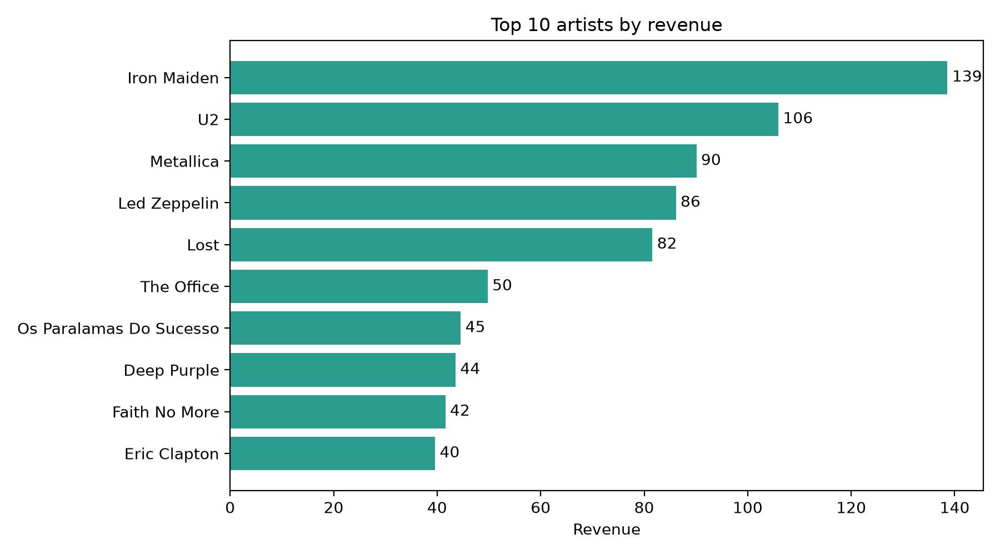
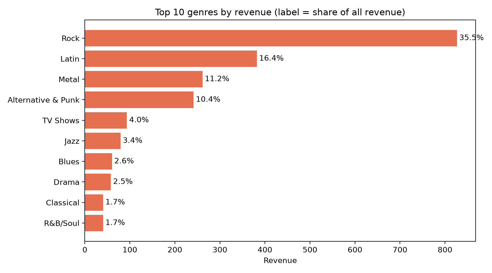
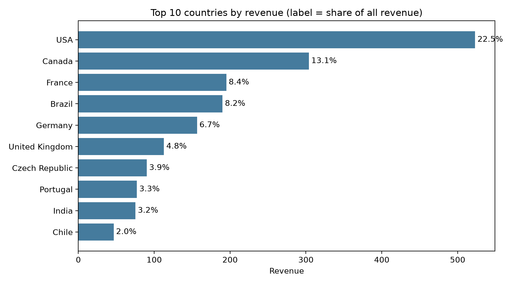
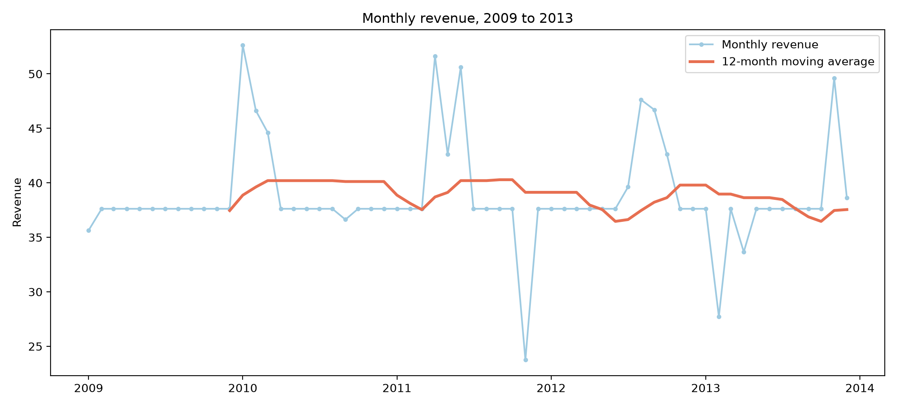

# Chinook Music Store: SQL Sales Analysis

Elevvo Data Analytics Internship, Task 5 (Level 2): SQL-Based Analysis of Product Sales.

**Business questions**
1. Which products (songs, artists, genres) sell the most?
2. How much revenue does each country bring in?
3. How do sales change month by month?

**Bonus:** window functions to rank genres, and to find the top artist in each genre.

**Answer in one line:** Rock brings 35.5% of revenue and the USA 22.5%, but sales are flat over five years, and songs are too small to rank: the best-selling song sold only 2 copies.



## Key results

| Question | Result |
|---|---|
| Database size | 59 customers, 412 invoices, 2,240 invoice lines, 3,503 tracks, 347 albums, 275 artists, 25 genres |
| Total revenue | 2,328.60 (the invoice lines and the invoices give the same total) |
| Top-selling songs | No song sold more than 2 copies. 1,519 of 3,503 songs (43%) never sold |
| Top artists | Iron Maiden is first with 138.60 (about 6%). The top 10 of 275 artists bring 31.0% |
| Genres | Rock 35.5%, Latin 16.4%, Metal 11.2%, Alternative & Punk 10.4% (top 4: 73.5%). 24 of 25 genres sold; Opera never did |
| Countries | USA 22.5% (523.06), Canada 13.1%, France 8.4%. The top 5 of 24 countries bring 58.8%. 15 countries have one customer |
| Over time | Flat: every year is between 449 and 481. No trend and no yearly season |







## What this project covers

- **Joins:** chains of up to 4 joins (invoice line, song, album, artist, genre). Every join was checked by counting rows.
- **Aggregation:** `GROUP BY`, `SUM`, `COUNT`, `COUNT(DISTINCT ...)`, `HAVING`, and subqueries.
- **Data checks:** revenue from invoice lines equals revenue from invoices, and each ranking adds up to the total.
- **Dates:** `strftime` to cut the year and month out of text dates.
- **Bonus, window functions:** `ROW_NUMBER`, `RANK` and `DENSE_RANK` on genres, and `RANK() OVER (PARTITION BY ...)` for the top artist in each genre.

## Repository structure

```
chinook_sql_sales/
├── data/
│   └── raw/             # chinook_sqlite.sqlite (not committed)
├── notebooks/
│   └── 01_sql_sales_analysis.ipynb
├── sql/
│   ├── 00_explore.sql
│   ├── 01_join_checks.sql
│   ├── 02_top_products.sql
│   ├── 03_revenue_by_country.sql
│   ├── 04_monthly_sales.sql
│   └── 05_window_function.sql
├── outputs/             # charts
├── README.md
└── requirements.txt
```

## Data

The Chinook sample database (SQLite version). Download `chinook_sqlite.sqlite` and place it in `data/raw/`. The database file is not committed to this repository. The Chinook project is open source: https://github.com/lerocha/chinook-database

## How to run

1. Put `chinook_sqlite.sqlite` in `data/raw/`.
2. **To read the SQL:** open the files in `sql/`. Each file has comments and can be run in any SQLite tool (for example the SQLite extension in VS Code).
3. **To see the results and charts:** run `pip install -r requirements.txt`, then run `notebooks/01_sql_sales_analysis.ipynb` from top to bottom. It uses the same queries and saves the charts to `outputs/`.

## Methodology

- **Revenue** is `UnitPrice x Quantity` on each invoice line, added up. The invoice totals give the same number (2,328.60), so either can be used.
- **Joins are on Id columns only.** Joining on `UnitPrice` (a column both tables share, but not a link) would match every 0.99 line with every 0.99 song and make millions of wrong rows.
- **Songs are not ranked**, because 1,728 songs sold 1 copy and 256 sold 2. Artists and genres have enough sales for a real ranking.
- **Ties use `RANK`**, which shows them honestly. `ROW_NUMBER` would hide them.
- **The genre belongs to the song, not the artist.** An artist can sell in several genres, so an artist's money is split across them.
- **Country** uses `BillingCountry`, which equals the customer's country on every invoice.

## Limitations

- Chinook is a sample database, and the data looks generated: nearly every customer has exactly 7 invoices, and 43 of 60 months have exactly 7 invoices and revenue of 37.62. Trends and seasons should not be read as real business signals.
- TV episodes cost 1.99 and music costs 0.99, so rankings by revenue and by units can differ (Lost is 5th by revenue and 8th by units).
- 2013 ends on 22 December, so it is not a full year.
- Revenue per customer is similar in all countries (37.6 to 46.6), so country rankings mostly show how many customers each country has. The highest values rest on only 1 or 2 customers.
- Some genres overlap by name (for example Rock and Rock And Roll, Metal and Heavy Metal) and are counted separately, as in the data.

## Tools

SQL (SQLite), Python (pandas, matplotlib), Jupyter.
